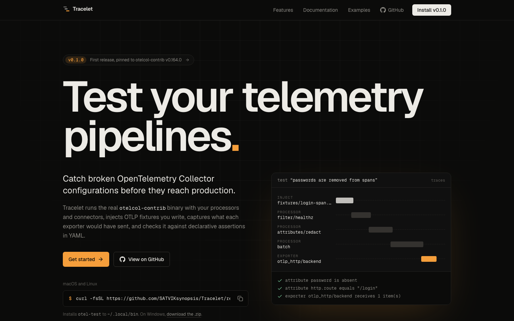
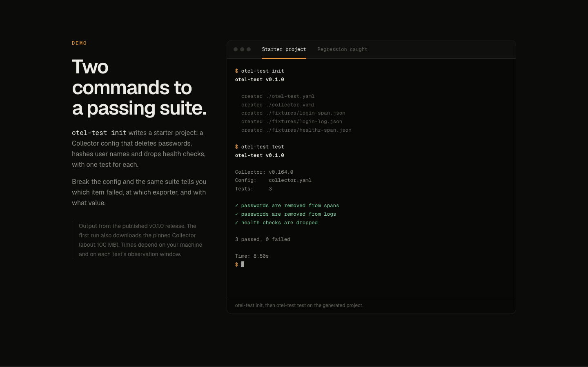
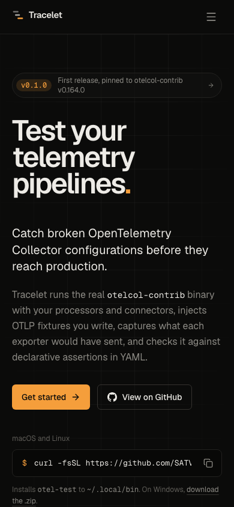
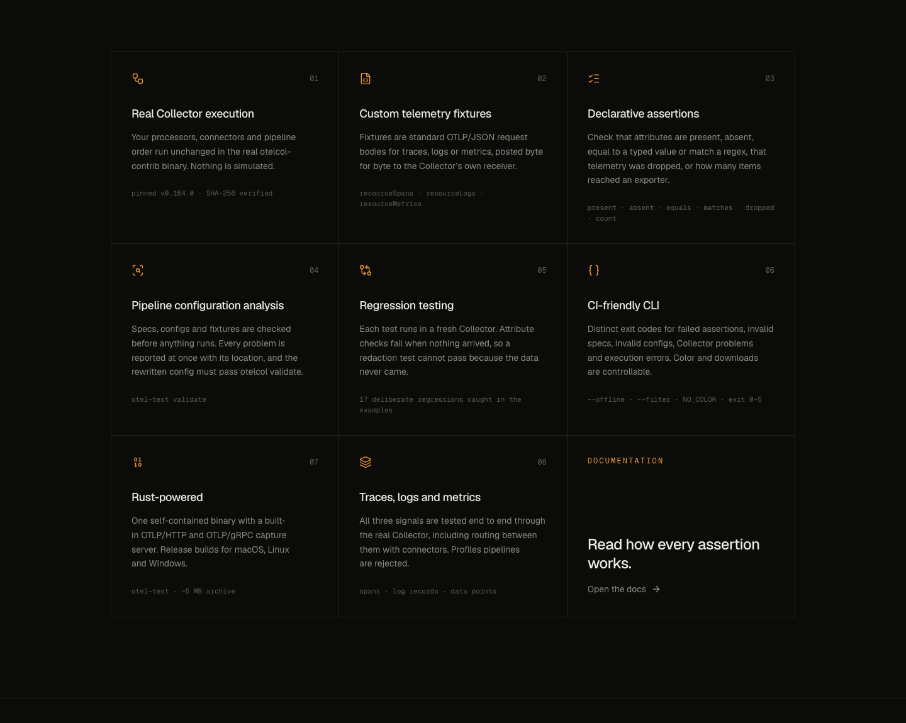
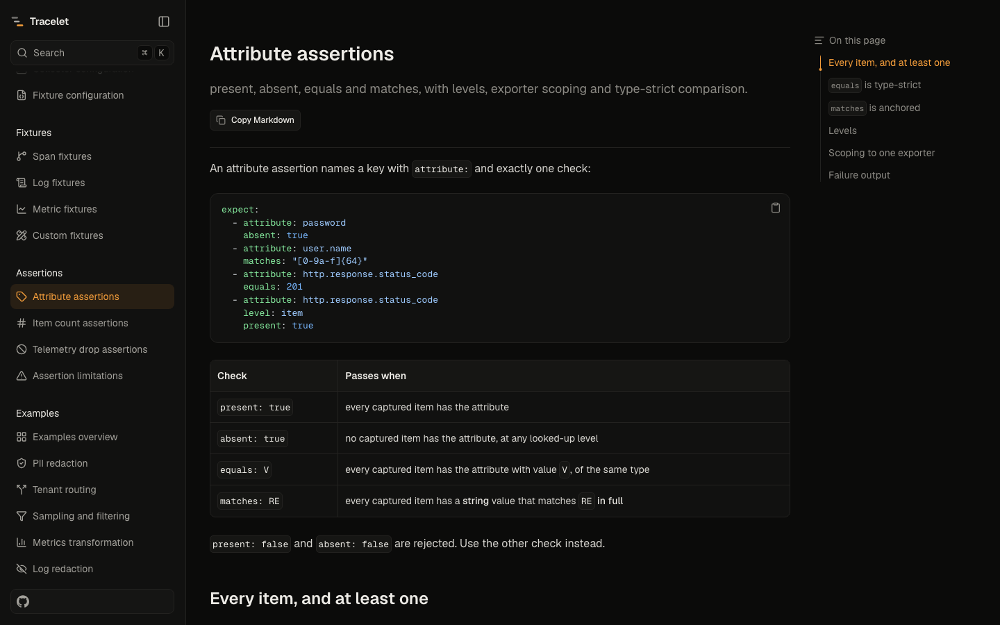
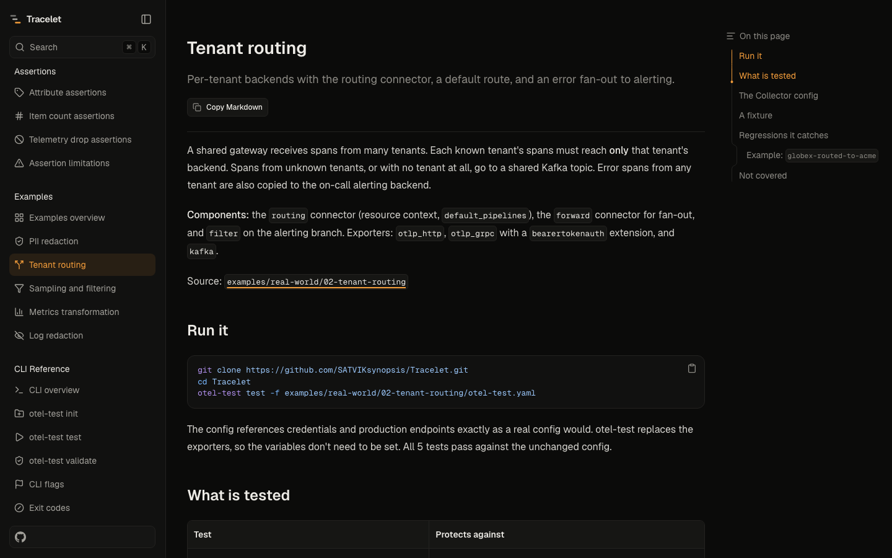

<div align="center">


# tracelet-web

**The website and documentation for [Tracelet](https://github.com/SATVIKsynopsis/Tracelet)**<br />
Integration tests for OpenTelemetry Collector configurations.

[](https://nextjs.org)
[](https://react.dev)
[](https://www.typescriptlang.org)
[](https://tailwindcss.com)
<br />
[](https://fumadocs.dev)
[](https://mdxjs.com)
[](https://lucide.dev)
[](https://nodejs.org)

[](https://github.com/SATVIKsynopsis/Tracelet/releases)
[](https://github.com/SATVIKsynopsis/Tracelet)
[](https://opentelemetry.io/docs/collector/)
[](https://github.com/SATVIKsynopsis/Tracelet/blob/main/LICENSE)

</div>

<br />

<p align="center">
  
</p>

## About

This repository contains the public site for **Tracelet**, an open-source Rust tool (the `otel-test` binary)
that runs the real OpenTelemetry Collector with your config, injects OTLP fixtures you write, captures what each
exporter would have sent, and checks it against declarative YAML assertions.

The site has two parts:

- **A landing page** that explains what Tracelet does, shows real CLI output, and covers installation.
- **A documentation site** with 34 pages, from installation to the assertion engine's limitations.

Everything on the site comes from the Tracelet source at `v0.1.0`. Command output was recorded from the
published `otel-test` v0.1.0 binary, and the example pages embed the real files from the Rust repository.

## Screenshots

<table>
  <tr>
    <td width="66%"></td>
    <td width="34%" rowspan="2" valign="top"></td>
  </tr>
  <tr>
    <td></td>
  </tr>
</table>

<table>
  <tr>
    <td width="50%"></td>
    <td width="50%"></td>
  </tr>
  <tr>
    <td align="center"><sub>Docs with sidebar, search and table of contents</sub></td>
    <td align="center"><sub>Example pages built from the real repository files</sub></td>
  </tr>
</table>

## Features

| | |
| --- | --- |
| **Landing page** | Hero with install command and copy button, terminal demo (passing and regression tabs), features, how-it-works diagram, the five real-world use cases, scope, per-platform install tabs |
| **Documentation** | Fumadocs with sidebar, full-text search, breadcrumbs, previous/next links, table of contents, syntax highlighting and copy buttons |
| **Content** | 34 MDX pages: Getting Started, Core Concepts, Configuration, Fixtures, Assertions, Examples, CLI Reference, Advanced |
| **SEO** | Page metadata, Open Graph images for every page, favicon, `sitemap.xml`, `robots.txt` |
| **Accessibility** | Semantic HTML, keyboard-operable menu and tabs, skip link, visible focus, reduced-motion support |
| **Design** | Dark theme, Geist type, one amber accent, no stock art or invented numbers |

## Getting started

Requires **Node.js 20 or newer** (developed on Node 26) and npm.

```bash
git clone <this repository> tracelet-web
cd tracelet-web
npm install
npm run dev
```

Open http://localhost:3000.

## Scripts

| Command | What it does |
| --- | --- |
| `npm run dev` | Start the dev server with hot reload |
| `npm run build` | Build for production |
| `npm start` | Serve the production build |
| `npm run lint` | Run ESLint |
| `npm run types:check` | Generate route types and run `tsc --noEmit` |

## Deploying

Set the public URL before building, so canonical links, Open Graph images, the sitemap and `robots.txt` use your
domain:

```bash
NEXT_PUBLIC_SITE_URL=https://your-domain.example npm run build
npm start
```

| Variable | Default | Used for |
| --- | --- | --- |
| `NEXT_PUBLIC_SITE_URL` | `http://localhost:3000` | `metadataBase`, `sitemap.xml`, `robots.txt` |

The site works on any Node host. On Vercel, import the repository and set `NEXT_PUBLIC_SITE_URL` in the project
settings. Search runs from the `/api/search` route, so a fully static export is not configured.

## Project structure

```text
app/
  (home)/              landing page and its layout (header, footer)
  docs/                Fumadocs layout and page renderer
  api/search/          search index built from the docs
  og/docs/             Open Graph images for docs pages
  opengraph-image.tsx  Open Graph image for the landing page
  icon.svg, sitemap.ts, robots.ts, global.css
components/
  home/                landing page sections (hero, terminal, features, ...)
  site/                header, footer, logo, copy button, install command
  mdx.tsx              components available inside MDX
content/docs/          documentation pages (MDX) and navigation (meta.json)
lib/
  site.ts              version, repository links, install command
  examples.ts          the five real-world examples on the landing page
  source.ts            Fumadocs content source
.github/readme/        screenshots used in this README
```

## Editing content

- **Docs pages** live in `content/docs/`. Each folder has a `meta.json` that sets the sidebar order. The root
  `meta.json` defines the section headings.
- **Page icons** are set with `icon:` in the frontmatter, using canonical [Lucide](https://lucide.dev/icons) names
  such as `FileBraces`.
- **Code blocks** support titles (` ```yaml title="otel-test.yaml" `) and diff notation (`// [!code --]`).
- **Theme colors** are tokens in `app/global.css` (`--color-ember`, `--color-canvas`, ...). The Fumadocs colors are
  mapped to the same tokens.

## Keeping the site in sync with Tracelet

The site documents a specific Tracelet release. When a new one ships:

1. Update `version` and `collectorVersion` in `lib/site.ts`, and the version strings in `content/docs`.
2. Re-check documented behavior against the Rust source: flags, assertion syntax, exit codes, limitations.
3. Regenerate `content/docs/examples/*.mdx` if `examples/real-world` changed. These pages embed `collector.yaml`,
   `otel-test.yaml`, fixtures and regression patches verbatim.
4. Re-record command output with the new binary.

## Related

- **Tracelet (Rust CLI):** https://github.com/SATVIKsynopsis/Tracelet
- **Releases:** https://github.com/SATVIKsynopsis/Tracelet/releases
- **OpenTelemetry Collector:** https://opentelemetry.io/docs/collector/

## License

Apache-2.0, the same as Tracelet.

<div align="center">
<sub>Tracelet is not affiliated with the OpenTelemetry project or the CNCF.</sub>
</div>
